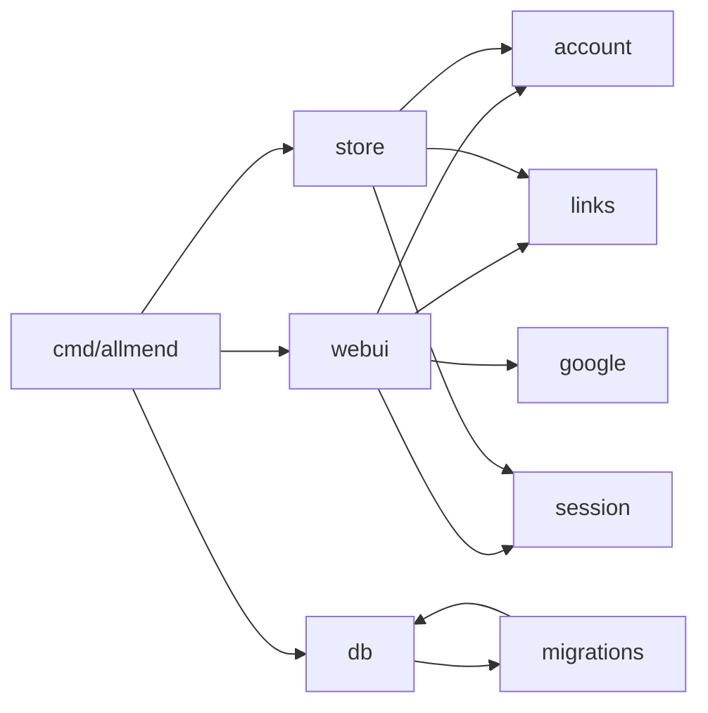

# 5 Building blocks

| Block | Responsibility |
| --- | --- |
| `cmd/allmend` | Composition root; subcommands `serve`, `migrate [--dry-run]`, `hashpw`, `health`. |
| `internal/env` | Configuration from `ALLMEND_*` variables; unknown ones fail. |
| `internal/db` | Open SQLite, migrate (backup, one transaction), counts. |
| `internal/migrations` | Ordered schema steps (global version numbers). |
| `internal/account` | Accounts, module access, admin role, login rules. |
| `internal/session` | Server-side sessions and pending Google logins. |
| `internal/google` | OpenID Connect with Google (stdlib, PKCE, RS256). |
| `internal/links` | Links on the start page. |
| `internal/pages`, `commute`, `velo`, `schiffe`, `places`, `ausgaben` | One package per module: types, rules, services, repository interface. |
| `internal/finanzen` | Finances: assets, securities, transactions, dividends, yearly snapshots; calculations; the daily market data refresh. |
| `internal/quotes` | HTTP adapters for market data: Alpha Vantage (prices, fund profiles), Frankfurter (exchange rates). Strict parsing. |
| `internal/store` | SQLite repositories; only `cmd` and tests import it. |
| `internal/webui` | Routes, middleware (CSP, cross-origin protection, auth), handlers. |
| `ui` | Embedded templates and static files. |

Layer rules: `internal/archtest`.
