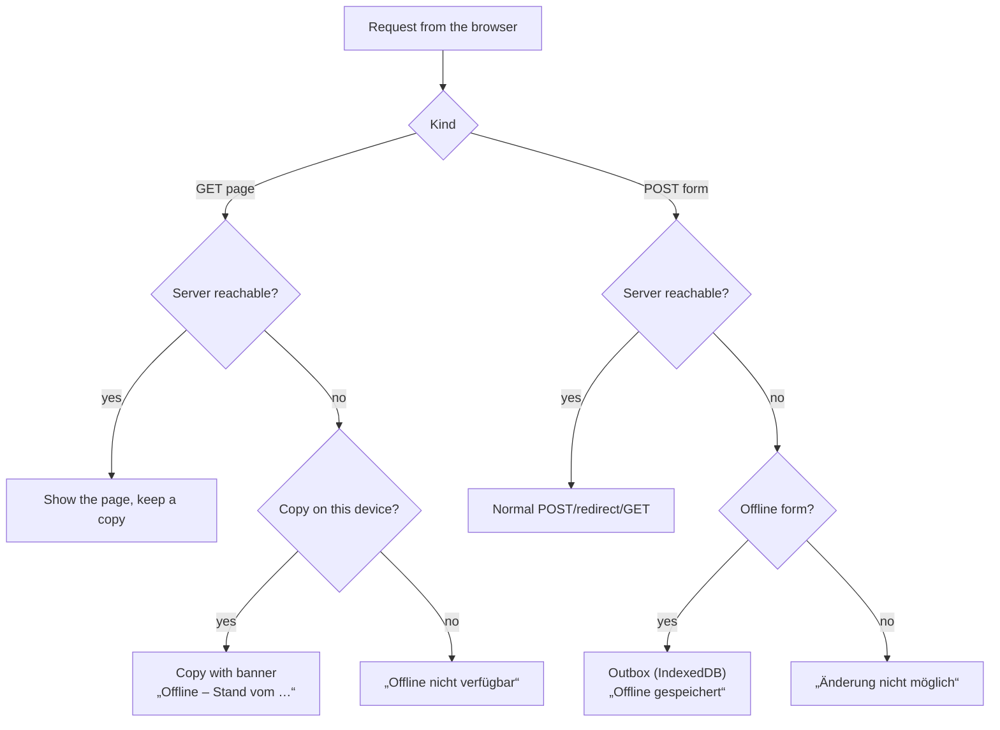
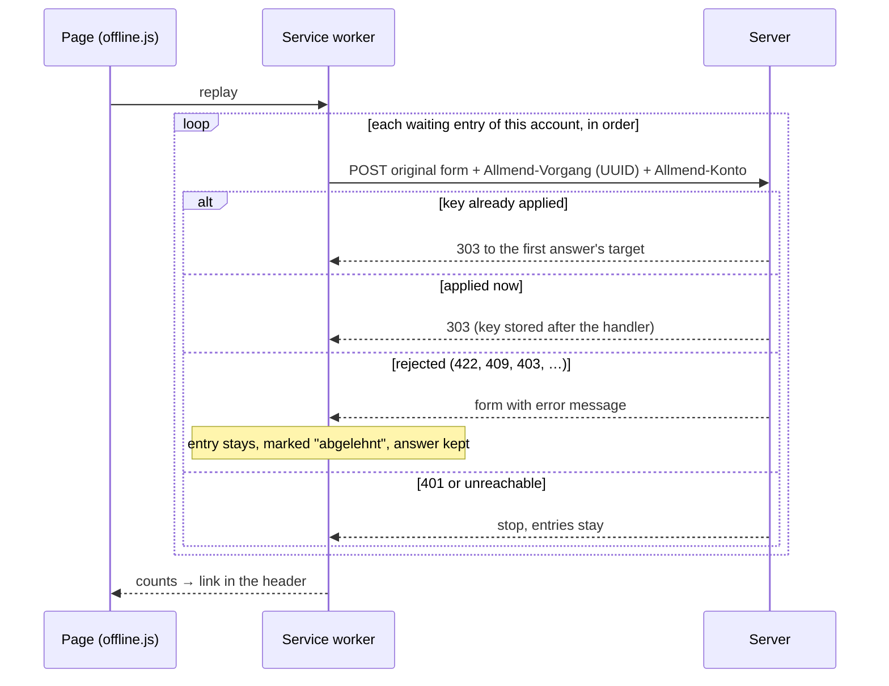

# 8 Cross-cutting concepts

## Valid data only

Never "shit in, shit out": unexpected input is an error, never guessed,
defaulted or silently dropped. Validation happens at the interface where data
enters Allmend — HTTP forms, environment, file imports, external APIs —
and is backed by database constraints (`STRICT` tables, `CHECK`, foreign
keys). Hence everything stored is valid, and code reading the database does
not re-check it.

## No data loss

Backup before every migration, one transaction per start, optimistic locking
(`version`) on every editable record, confirmations for deletes, revisions for
pages. See the ADR on migrations and backup.

## Access

Module access per account; data scope per module fixed in code; repositories
filter by owner in SQL. See the ADR on access and data scope.

## Offline

Allmend keeps working while the server is unreachable (ADR offline). One
service worker (`ui/static/sw.js`, served as `/sw.js`) sits between browser
and server; online it changes nothing.

| Offline | What |
| --- | --- |
| Read + write | Ausgaben: add an entry. Arbeitswege: change a year. Velo: add a tour. |
| Read only | Every other page this account has opened on this device before. |
| Nothing | Schiffe versenken, login, logout. |

The list of offline forms is `offlineWrites` in `internal/webui/offline.go`;
the server writes it into the worker, so there is one source.

"Unreachable" is a network error, a timeout (8 s) or 502/503/504 (the reverse
proxy answers those when Allmend is down).

### Transfer

On every page load and on the browser's `online` event the worker sends the
waiting entries one by one, as the original form request plus two headers.

- The server checks a replay like any request (forms, versions, access) and
  additionally: only the offline forms, a valid UUID, the header account is
  the session's account, a key never belongs to two accounts. A key is
  stored after the handler's redirect, not in its transaction (accepted
  risk of a duplicate after a crash, #24).
- A rejected entry is never dropped: the page "Nicht übertragen" (`/offline`)
  lists it; "Antwort ansehen" shows the server's answer — the form with the
  error and the user's values — and sending that form again replaces the
  entry. Or the user discards it.

### Cache and privacy

- Only pages with the header `Allmend-Konto` (logged in) and without
  `Cache-Control: no-store` are kept; pages with a one-time message are
  `no-store`. A different `Allmend-Konto` drops every copy.
- Outbox entries keep the account they were made with and are never sent
  with another one.
- Logout answers `Clear-Site-Data: "cache", "storage"` (copies, outbox and
  worker gone). The logout button warns first while entries are waiting.
- Cache names carry a hash of the static files, so a release drops old caches.
