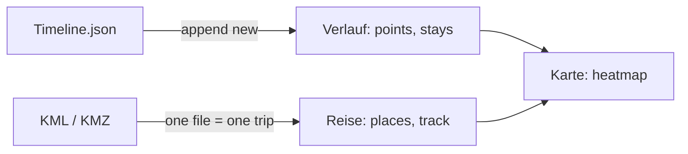

# ADR-20261115: Orte — trips, location history, heatmap

Status: Accepted

## Context
Orte only half works (#6): trips exist only from the legacy import (removed
in 0.4.0), and the only import, Google `Records.json`, is no longer offered
by Google — the phone exports `Timeline.json` (`semanticSegments`). Markus
wants to record single trips and holidays and to follow his Google location
history, plus a map of everywhere he has been. (stated)

## Decision

- **Three views:** *Reisen* (trips), *Verlauf* (location history per day),
  *Karte* (heatmap of everything).
- **Trip** = name, description, date range, places, optional track. Created
  by importing one KML/KMZ file (Points → places, `gx:Track`/LineString →
  track). Name, description and range come from the file
  (`Document`, `TimeSpan`, track times); fields filled in the import form
  win. No range from file or form → refused. The same file (SHA-256) twice →
  refused. Trips can be edited and deleted (with their places and track).
- **Timeline import** (`Timeline.json` from Google Maps on the phone):
  - Taken: `timelinePath` points and `visit` stays (start, end, position,
    `semanticType`; no name — the file has none). Not taken: `rawSignals`,
    `userLocationProfile`, activity segments. (stated)
  - **Append only:** per account the newest stored time is the mark; only
    entries after it are stored, older ones are skipped and counted. If the
    file starts after the mark, the result says so (gap). (stated)
  - Strict: any malformed or unknown segment aborts the whole import.
  - Each import is recorded (file name, time, counts) and can be undone
    as a whole; the mark follows.
  - The `Records.json` import is removed; points already stored stay.
    (stated)
- **Time:** stored UTC plus the UTC offset of the source. A day in Verlauf
  is the local day at the point; points without offset (old data) use
  `Europe/Zurich`.
- **Visibility** (replaces the Orte row of ADR access-and-data-scope):
  trips are *private, readable*; Verlauf and Karte are *private* — only the
  owner. On his own trips the owner can show the Verlauf of the trip's
  range. (stated)
- **Karte:** classic heatmap (stated). The server sums points per cell of
  the current zoom and view and sends weighted cells, never raw points.
  Drawn with **Leaflet.heat** (MIT, few KB, vendored like Leaflet; new
  dependency, accepted with this ADR).
- Offline: all Orte pages stay read-only offline (ADR offline).

## Data
- New migration step: `place_imports`; track points move to their trip;
  stays get their own table; points get `utc_offset_min` (NULL for old
  data). Existing data is kept.
- **Trips without a range:** old trips keep an empty range (they all lack
  one). The list marks them red („Zeitraum fehlt“); the edit form requires
  both dates, so saving fills the gap. New imports always need a range.
  (stated)
- `internal/places` gets a service (like the other modules); the demo seeds
  a trip, Verlauf days and so the heatmap.

## Why
KML/KMZ is how Markus records trips; `Timeline.json` is the only export
Google still offers. Append-only keeps the import simple and safe: stored
history never changes behind his back. A location history is the most
sensitive data in the app, so it stays with its owner.
