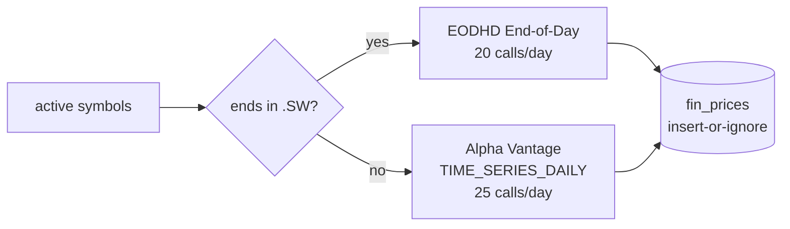

# ADR-20261121: SIX prices from EODHD

Status: Proposed

## Context
Alpha Vantage does not serve SIX Swiss Exchange titles: `TIME_SERIES_DAILY`
answers "Invalid API call" for `.SW` symbols (HBAN, MOZN, RO, STMN), and its
documented exchange suffixes do not include SIX. Securities in CHF on SIX
therefore get no prices, no value and no gain.

Free sources with SIX end-of-day data (checked 2026-11-21):

| Source | SIX on free plan | Limit | Verdict |
| --- | --- | --- | --- |
| EODHD | yes (`.SW`) | 20 calls/day, 1 year history | chosen |
| SIX closing-price files | yes, official | none stated | no documented URL or terms, about one month kept: scraping |
| Marketstack | yes | 100 requests/month, HTTPS only paid | too tight |
| Twelve Data | no (Pro plan) | – | out |
| Financial Modeling Prep | no (US only) | – | out |
| Stooq, Yahoo | unofficial | – | not a stable interface |

## Decision
- Symbols ending in `.SW` get their daily closes from EODHD (End-of-Day API,
  unadjusted `close`); every other symbol stays with Alpha Vantage. The suffix
  decides; there is no per-security source field.
- New adapter `quotes.EODHD` with the standard library only (no new Go
  dependency), implementing the existing `Daily`. EODHD gives no composition:
  `.SW` ETFs and funds get none from the provider, the manual weights apply.
- Key in `ALLMEND_EODHD_KEY` (secret, like the Alpha Vantage key). Own budget
  of 20 calls/day, counted separately from Alpha Vantage's 25.
- No key but `.SW` symbols in use: the run says so as an error and fetches
  none of them. No fallback to Alpha Vantage, no guessed prices.
- A symbol with no stored price yet loads the year of history the free plan
  gives, once; afterwards only the last days. Stored closes are never
  changed or fetched again (as in [daily prices](ADR-20261109-finance-daily-prices.md)).
- The response is validated like Alpha Vantage's (`ParseDaily` rules): dates,
  positive closes, no empty series; anything else is an error for that symbol.

## Consequences
- Swiss titles get prices again in CHF; symbols stay as they are (`RO.SW`).
- A second external service and key to keep. EODHD calls its free plan
  "enough to try the endpoints out, not to run an application"; four calls a
  day are well inside it, but the plan may change. If it goes, only `.SW`
  prices stop, with an error in the run.
- Prices older than one year for a new Swiss title come only from imports.
